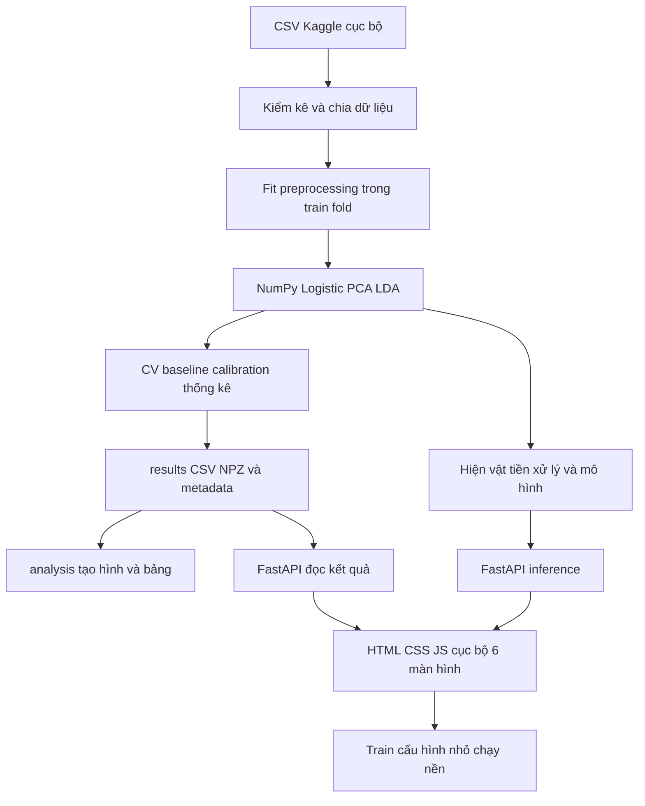

# Thiết kế hệ thống dự kiến

## Hai luồng riêng

Huấn luyện nghiên cứu offline; inference online cục bộ; kết quả thống kê đọc từ results/. Màn train nhỏ có job id, tiến độ, trạng thái, dừng hợp tác; không chặn request. Một tiến trình ứng dụng và một tác vụ demo tại một thời điểm là đủ phạm vi, chưa cần Redis/Celery/database.

## Hợp đồng giao tiếp dự kiến

| Thành phần | Hợp đồng |
|---|---|
| Preprocessor | fit(X_train), transform(X), feature_names; không thay đổi thứ tự cột khi nạp lại |
| PCA | fit(X), transform(X,k), inverse_transform(Z); mean/components/variance |
| LDA | fit(X,y), transform(X) 1D; direction và metadata |
| Classifier | fit(X,y), predict_proba(X) có xác suất lớp 1 rõ, predict(X,threshold) |
| Artifact | preprocessing + reducer + model + calibration nếu có + threshold + config/version/hash |
| Experiment record | config_id, seed, fold, k, metrics, threshold, timing, provenance |

API dự kiến: GET /api/thong-ke; GET /api/mau; POST /api/du-doan; POST /api/train; GET /api/train/{job_id}; POST /api/train/{job_id}/stop; GET /api/pca?k=…; GET /api/results; GET /api/threshold?value=… . Đây là hợp đồng dự thảo, chưa phải endpoint đang chạy.

Đầu vào validate kiểu/phạm vi học từ dữ liệu và đặc tả; lỗi trả mã HTTP và thông báo trong trang. POST dự đoán không lưu hồ sơ nhập. Khi đổi mô hình phải nạp đúng chuỗi biến đổi cùng phiên bản.

## Cấu trúc

data/, models/, experiments/, analysis/, app/, tests/ theo 07b; docs/, reports/, results/, presentations/ phục vụ hồ sơ. Không tạo src/ trùng. Bên trong app/ sau này có main.py, api/, static/css/, static/js/ và models/ chứa hiện vật. Root models/ là mã thuật toán, app/models/ là dữ liệu mô hình đã fit; không nhầm hai vai trò.

## Kiểm thử và triển khai

Unit: thuật toán, gradient, metrics, reducer. Integration: train-only preprocessing, save/load cùng dự đoán, API input/error/cancel job. Scientific: cùng fold và đủ 25 record, provenance và độ đo đúng. Acceptance: 6 màn hình, 1920/768, user testing, offline trên máy khác, tái lập ba lệnh.

Chưa thêm GitHub Actions khi chỉ có tài liệu. Sau khi có test đầu tiên: CI chạy test nhẹ bằng dữ liệu tổng hợp, không tải Kaggle/huấn luyện đủ CV, không cần secret. Chạy full experiment cục bộ. Release chỉ sau nghiệm thu; kèm manifest và kết quả thực tế, không kèm credential/dataset thô.
